# Карта переходів кроків флоу (для `flow-orchestrator`)

## Схема пулу A (від A-01 до A-18; 0.4.0)
Шість етапів: **1 Дослідження й концепція → 2 Ринок → 3 Рішення → 4 Збірка → 5 Наповнення → 6 Реліз**. Нумерація етапів — для рядка позиції «етап N з 6» у звітах (`report-format.md`, E2). Таблиці нижче — єдине джерело переходів; схема лише ілюструє. Пунктир — необов'язкова гілка або маршрут-виняток.

```mermaid
flowchart LR
  subgraph S1["1 Дослідження й концепція"]
    A01["A-01 скоринг галузей"] --> A02{{"A-02 галузь (гейт)"}}
    A02 --> A02b["A-02b анкета власника"]
    A02b --> A03["A-03 довідка"]
    A02b --> A04["A-04 минулі проєкти"]
    A03 -.-> A05["A-05 → A-06 сесії"]
    A03 --> A03b["A-03b глибокий аналіз"]
    A04 --> A03b
    A05 -.-> A03b
    A03b --> A03c["A-03c готові модулі"]
    A03c --> A20["A-20 концепція + повнота"]
    A20 --> A20c{{"A-20c сторінка власника (гейт)"}}
    A20c --> A21{{"A-21 реальний зріз td_* (гейт)"}}
    A21d["A-21d огляд покриття зрізу (slice-coverage)"]
  end
  subgraph S2["2 Ринок"]
    A21c{{"A-21c продаючі матеріали (гейт)"}} --> A23["A-23 тест попиту"]
    A23 -.-> A22["A-22 база для гарячого ліда"]
  end
  subgraph S3["3 Рішення"]
    A07{{"A-07 будуємо? (гейт-вето)"}}
  end
  subgraph S4["4 Збірка"]
    A08{{"A-08 SPEC: from-slice або перша (гейт)"}} --> A09{{"A-09 анкета (гейт)"}} --> A10{{"A-10 розподіл (гейт)"}}
    A10 --> A11["A-11 модулі td_*"]
    A10 --> A12["A-12 конфіг"]
    A10 --> A13["A-13 майстер-дані"]
    A11 --> A14{{"A-14 гейти якості"}}
    A12 --> A14
    A13 --> A14
    A14 --> A15["A-15 демо-стенд"] --> A16["A-16 тури"] --> A16b["A-16b інструкції користувача"]
    A16b --> A17{{"A-17 приймання: власник тестує стенд (гейт)"}}
  end
  subgraph S5["5 Наповнення"]
    A17b["A-17b електронне навчання"]
    A17c["A-17c інструкції для AI-підтримки"]
  end
  A17c -.->|"дефект тексту інструкцій"| A16b
  A16b -.->|"стенд/демо-дані"| A15
  A16b -.->|"права ролей / код"| A11
  A16b -.->|"конфіг"| A12
  A16 -.->|"стенд/демо-дані"| A15
  A17c -.->|"reconcile перед A-18 (elearning on)"| A18
  subgraph S6["6 Реліз"]
    A18{{"A-18 реліз і тег (гейт)"}}
  end
  A21 --> A21d
  A21d --> A21c
  A21d -. "skip_market_check (E4)" .-> A07
  A23 --> A07
  A07 --> A08
  A17 --> A17b
  A17 --> A17c
  A17b --> A18
  A17c --> A18
  A14 -. "дефекти" .-> A11
  A15 -. "дефекти стенда" .-> A14
  A16 -. "дефект модуля" .-> A14
  A17 -. "ТР/AC" .-> A08
  A16b -. "дефект UI" .-> A14
  A17b -. "дефект уроку" .-> A16b
  A17b -. "дефект модуля" .-> A14
  A17c -. "дефект модуля" .-> A14
  A17 -. "дефект реалізації" .-> A14
  A18 -. "release-defects" .-> A14
```

Джерело — картки кроків (`inArtifacts`, `escalation`, `notes`) і опис флоу (пули A, B, C, D). Це єдина таблиця, за якою оркестратор ставить наступні задачі. **Переходу немає в таблиці — задачу не створювати:** стоп, `mail.activity` Тімліду (`odoo-bridge.md` §8) з `from` і результатом, запис пропозиції рядка в `flow/open-questions.md`. Файл змінює лише людина (Тімлід) через PR; рядки, позначені «відкрито», оркестратор виконує лише після рішення людини в задачі.

## Позначення
- `Вихід` — що завершило `from`: `done` (звіт `result: done` + автоперевірка пройдена), `Затвердити` / `Повернути` (кнопка гейта, `odoo-bridge.md` §5), `вердикт` (значення в артефакті), `повідомлення` (подія між пулами).
- `AND-split` — створити всі `to` разом; `AND-join` — створити `to` лише коли `done` усі джерела на тому самому `scope.id` і версії.
- `Код повернення` — звідки оркестратор бере `to` при поверненні: `gate.return_to` (задає людина з допустимих у колонці), `артефакт:<файл>` (код у файлі), `картка` (фіксований).
- Кроки з режимами (`params.mode`) — `naryad-format.md`.

## Пул A: створення пакета (scope: package)
| from | вихід | to | умова / шлюз | код повернення | картка |
|---|---|---|---|---|---|
| C-00 | done | A-01 | старт флоу: людська частина (доступи, сервери) + автоматичний передкрок «розгорнути `tools/odoo` з `templates/tools-odoo`» (runner за `c00-checklist.md`, без наряду людині) | | C-00 |
| A-01 | done + Затвердити | A-02 | | Повернути -> A-01 | A-01 |
| A-02 | Затвердити (галузь обрана) | A-02b | | Повернути -> A-01 (gate.return_to) | A-02 |
| A-02b `prepare` | waiting_human (анкета підготовлена, власник заповнює ≤5 хв, 6 пунктів) | A-02b `validate` | `human_substep` + `resume {mode: validate}`; наряд `validate` ставить оркестратор після відповіді | | A-02b |
| A-02b `validate` | waiting_human (блокуючі поля `*` порожні/FAIL) | A-02b `validate` (resume) | питання власнику; наступників не ставити | | A-02b |
| A-02b `validate` | done (блокуючі поля `*` заповнені) | A-03, A-04 | AND-split; правка анкети власником = новий наряд `validate` (режиму `amend` немає) | | A-02b |
| A-03 | done | шлюз «Потрібні сесії?» | значення `defaults.ambition.sessions_a05_a06` з `OWNER-INTAKE.md` (К-14), а не поле на гейті A-03 | | A-03 |
| шлюз | так | A-05 -> A-06 | необов'язкова гілка | Повернути -> A-03 | A-05, A-06 |
| шлюз | ні | A-03b (join) | | | A-03b |
| A-04 | done | A-03b | AND-join з A-03 (і A-06, якщо сесії були) | | A-03b |
| A-06 | done | A-03b | AND-join | | A-03b |
| A-03b `зразок` (необов'язковий) | waiting_human лише за явного `params.sample: true` (запит людини або перша галузь пакета: профіль одного конкурента + 10 рядків матриці); за замовчуванням `sample: false`, зупинки немає | A-03b (resume, повний обсяг) | `human_substep` приймання; послідовність A-03b: зразок -> приймання -> збір -> синтез (підсегмент і «не робимо» вирішує AI, рядки AI-DECISIONS) -> done; `resume {sample: false}` після зразка | зразок не прийнято -> A-03b | A-03b |
| A-03b | done | A-03c | відповідей власника не чекаємо: AI вирішує сам, рядки AI-DECISIONS | | A-03c |
| A-03c | done (один наряд: `## Інвентар` + рішення «беремо / адаптуємо / ні» в `REUSE.md`, рядки AI-DECISIONS; гейта немає) | A-20 | вето власника — лише на A-20c | | A-03c |
| A-20 | done (включає самоперевірку повноти — розділ «Повнота», 0.3.1) | A-20c | гейта немає (єдиний гейт — A-20c); A-20 пише BOX, SALES, REJECTED, AI-DECISIONS (OWNER-BRIEF не пишеться); брак болів/розмітки/тріалів не зупиняє крок, слабкий довід = «ризик, перевірити на пілоті» і йде в план A-23; самоперевірка в кінці кроку: `completeness-audit` як під-скіл (3 ролі, 14 пунктів, 1 коло), результат — розділ «Повнота» в `AI-DECISIONS.md`, кабінетні прогалини закриваються правкою документів у тому ж наряді, незакрите -> рядки AI-NN «ризик, перевірити на пілоті» (повернення не створюють) | | A-20 |
| A-20c `зразок` (необов'язковий) | waiting_human лише за явного `params.sample: true` (запит людини або перша галузь пакета; перший екран сторінки, N-18); за замовчуванням `sample: false`: одразу повний обсяг і гейт | A-20c (resume, повний обсяг) | `human_substep`: власник/BA приймає стиль сторінки до повного обсягу | зразок не прийнято -> A-20c | A-20c |
| A-20c | done + Затвердити (єдиний гейт дослідження, вето-цикл: Власник продукту/власник) | A-21 | сторінка власника (1 Artifact, 3 сторінки): висновок без грошей, біль, сценарій, екрани, блок «Що вирішив AI і з яким ризиком», ризики, «не робимо»; Затвердити = немає заперечень | Повернути (з рядками `AI-NN: не згоден — <що замість>`) -> A-20 `recalc` (сам оновлює «Повнота») -> A-20c (показує лише змінене); `gate.return_to` ∈ {A-20, A-03b, A-03c} | A-20c |
| A-21 `зразок` | waiting_human (`params.sample: true`, N-18) | A-21 (resume, повний обсяг) | `human_substep`: власник/BA приймає зразок; `ACCEPTED.md` | зразок не прийнято -> A-21 | A-21 |
| A-21 | done + Затвердити (гейт зрізу) | A-21d (огляд покриття) | реальний зріз Odoo 19 `td_*`, `facts.json`, безперервний запис (К-05, К-10); `defaults.prototype.fidelity: mock` -> `waiting_human` (К-23) | Повернути -> A-21 або A-20 (картка A-21: прототип із непройденими сценаріями -> BA) | A-21 |
| A-21d | done (огляд покриття зрізу; не гейт: рішення власника — вето через `veto-batch`) | A-21c (звичайний маршрут) або A-07 (`skip_market_check`; також після A-23 маршрут лишається A-23 -> A-07) | `completeness-audit` `params.mode: slice-coverage` (E3): `research/COVERAGE-SLICE.md` + рядки `AI-DECISIONS.md`; обов'язковий, пропуск — дефект карти (`observations/`); профіль `research`, `client_data: none` | незакриті прогалини — не повернення, а рядки AI-NN «ризик, перевірити на пілоті»; рекомендації «в A» входять у `from-slice` SPEC A-08 | A-21d |
| A-21c `зразок` | waiting_human (`params.sample: true`: 15 с + 1 кадр титра) | A-21c (resume, повний обсяг) | `human_substep` приймання | зразок не прийнято -> A-21c | A-21c |
| A-21 | Затвердити + рішення власника `skip_market_check` («без тесту попиту», E4) | A-21d, далі A-07 (A-21c, A-23, A-22 не ставляться) | маршрут-виняток: A-21c, A-23, A-22 не ставляться; AI вносить рядок AI-NN «ризик: без підтвердженого попиту» в `AI-DECISIONS.md` і рядок рішення в `flow/decisions.md` («внесено AI від імені власника», E6); рішення й артефакти, що залежать від результатів A-23 («розробка чекає сигналу тесту попиту»), позначаються застарілими автоматично (`check_stale.py`, N-07); A-07 приймає рішення за розділом «Рекомендація AI для A-07» у `AI-DECISIONS.md` замість `demand/results.md` | | A-21 |
| A-21c | done + Затвердити (гейт; виконавець — Контент-менеджер, `executor: any`) | A-23 `список` | продаючі матеріали; перемонтаж без перезйомки й без доступу до Odoo (К-10) | Повернути -> A-21c або A-21 | A-21c |
| A-23 `список` | waiting_human (потрібні адреси) | A-23 `адреси` | executor: central | | A-23 |
| A-23 `список` | done | A-23 `prep` | другий наряд того самого кроку (`params.mode`), створює `flow-orchestrator`; `адреси` — окремий наряд лише для центрального агента | | A-23 |
| A-23 | запит гарячого ліда | A-22 | паралельно, не блокує A-23; A-22 = «база зрізу для гарячого ліда» (лише зріз `td_*`, без `x_`-моделей, К-11) | | A-22 |
| A-23 `results` | done (розділ «Рекомендація AI для A-07» у `demand/results.md` за сигналами й порогами) | A-07 | | Повернути -> A-20 (змінити концепцію) | A-23 |
| A-23 | сигнали нижче порогів 2–3 тижні | рішення Власника продукту (role_task): змінити концепцію (A-20) або відкласти | ескалація картки A-23, без автопереходу | | A-23 |
| A-23 | гарячі ліди | B-01 (передача) | подія-повідомлення, без блокування | | A-23, B-01 |
| будь-який крок | зміна рішення власника / `facts.yaml` | по одному наряду `params.mode: recalc` на крок-власник застарілих артефактів (`params.stale`, `where`; крок — за `flow/ARTIFACTS.md`; порядок — за `DEPENDS.yaml`) | перерахунок застарілого (N-07); `check_stale.py` виконує runner у наряді-джерелі події (C-02 `record`/`veto-batch`, A-02b `validate`, PR із `facts.yaml`), список — `stale:` його звіту; ставить оркестратор; ключ `(step, scope.id, mode=recalc, base_sha)` | | C-01 |
| A-07 | Затвердити «будуємо» (кнопка; вето за рекомендацією AI в `demand/results.md` або, при `skip_market_check`, в `AI-DECISIONS.md`; `business-case.md` не пишеться) | A-08 | `params.mode: from-slice`, якщо є зріз A-21 (`prototype-real/PLAN.md` + `complexity`) — короткий SPEC без повного ТР (E2); без зрізу — `перша` (повний ТР) | Повернути/«ні» -> кінець флоу пакета (стан «не будуємо») | A-07 |
| A-08 | done + Затвердити | A-09 | | Повернути -> A-08 | A-08 |
| A-09 | done + Затвердити | A-10 | | Повернути -> A-08 (причина у вході) | A-09 |
| A-10 | done + Затвердити | A-11, A-12, A-13 | AND-split | Повернути -> A-08 (рішення Архітектора; відкрито: рядок n31 у карті C-01) | A-10 |
| A-11, A-12, A-13 | done кожен | A-14 | AND-join; для повторів після «правки» — лише гілки з правками | | A-14 |
| A-14 | вердикт APPROVE | A-15 | | | A-14 |
| A-14 | вердикт «правки» | A-11 і/або A-12 і/або A-13 | AND-split за кодами з CHECKS.md; 3 цикли без APPROVE -> ескалація Архітектору | артефакт:CHECKS.md | A-14 |
| A-15 | done | A-16 | | дефекти стенда -> A-14 (не напряму на A-11/12/13) | A-15 |
| A-16 | done (сценарії пройдені) | A-16b | | стенд/демо-дані -> A-15; модулі/конфіг/майстер-дані -> A-14 | A-16 |
| A-16b | done (посібники ролей і адміністратора, картки, INDEX із покриттям і SHA; `check_guides.py` без FAIL) | A-17 (§27 `td_home_menu`, `td_support` є в `package/addons` і змінені після SHA гейтів — контур коду 1: A-11-fix -> A-12-fix -> A-14 -> A-15-full -> A-16 -> A-16b; виняток, модулів ще немає — A-16b іде без них з рядком AI-NN, після злиття той самий контур; R-18, R-20) | виконавець AI, рецензія — Контент-менеджер/власник за `review-checklists/user-guide.md`, **плюс обов'язковий незалежний аудит покриття (3 рецензенти з різних кутів, цикл до нуля зауважень, `review_rounds` у звіті; 0.4.1)**; профіль `repo` | дефект UI, знайдений під час зйомки -> A-14 (не правка модуля тут); **права ролей / код** (UG-access: меню чи кнопка, названі в кроці ролі, недоступні групам ролі; AccessError під роллю) -> `returned_to: A-11` (конфіг — A-12), далі контур A-11 -> A-12 -> A-14 -> A-15-full -> A-16 -> A-16b; **конфіг** (ролі, параметри, «Модулі до установки») -> A-12; стенд/демо-дані -> A-15; сценарій SPEC без розділу -> A-16b | A-16b |
| A-17 | Затвердити (прийнято; включає «власник тестує стенд за інструкціями A-16b» — рядок картки й чек-листа, стенд локальний `package/demo/up.sh`; рішення про сервер відкрите) | A-17b, A-17c | AND-split (після прийняття, 0.4.0); точка тестування власником — частина A-17, окремого наряду немає | невідповідність ТР/AC -> A-08; дефект реалізації -> A-14 з обов'язковим повтором A-15 -> A-16 -> A-16b -> A-17 (код ставить Власник продукту; стрілку «дефект реалізації» на діаграму внесено); від D-03 -> D-03 | A-17 |
| A-17b | done (модуль `td_<галузь>_elearning`: курс на роль, уроки з A-16b, тести з порогом `elearning.pass_score`; `check_elearning.py` без FAIL) | A-18 | AND-join з A-17c (`done` обох на тому самому `scope.id` і версії); профіль `repo`; при elearning on після `done` обох оркестратор ставить наряд A-17c `params.mode: reconcile`, A-18 — після його `done` | дефект уроку/тексту -> A-16b; дефект модуля -> A-14 | A-17b |
| A-17c | done (`package/support/`: AI-INSTRUCTIONS, kb/KB-NNN, INDEX; `check_kb.py` без FAIL) | A-18 | AND-join з A-17b (при elearning on далі `params.mode: reconcile` — ставить оркестратор); `package/support/` лишається в ToDo, у клієнтську передачу не йде | прогалина в інструкціях -> A-17c; дефект тексту інструкцій (джерело — A-16b) -> A-16b; дефект поведінки модуля -> A-14 | A-17c |
| A-18 | done + Затвердити (фаза release) | A-18 `params.phase: tag` (наряд-тег, див. нижче) | оркестратор створює другий наряд того ж кроку | Повернути за артефактом `release-defects.md` -> A-14 (виправлення A-11/12/13, повтор A-15 -> A-16 -> A-16b -> A-17 -> A-17b ∥ A-17c) | A-18 |
| A-18 | done фаза tag + тег виставлено | повідомлення «Версія пакета випущена» -> B-01 (щойно версія вийшла), B-11 (повідомлення «Нова версія пакета») | AND-split; B-01 — лише для пілотного клієнта до «Тираж дозволено» | | A-18 |

Фаза `tag` A-18: рядок «гейт A-18 Затвердити -> наряд A-18 `params.phase: tag`» обов'язковий. Наряд-тег лише формує команду `git tag -a … && git push origin <тег>` у блоці `release`; виконує її runner (як push гілки) або job CI; субагент тег не пушить. Тег немає кому виконати — `escalated_to: Тімлід`.

## Пул A: гілки поза основним потоком
| from | вихід | to | умова | код повернення | картка |
|---|---|---|---|---|---|
| D-04 | Затвердити (план версії) | A-08 `params.mode: нова-версія` | повідомлення «Зміни для нової версії пакета» (лише D-04 шле) | | A-08, D-04 |
| B-09, B-10, B-08a | повідомлення «Дефект пакета (hotfix)» | A-19 | critical/high; низький -> D-02 | | A-19 |
| B-11 | повідомлення «Дефект пакета (hotfix)» | A-19 | дефект на новій версії | | B-11 |
| A-19 | done | A-14 (злиття перед A-18) | | | A-19 |
| A-14 (hotfix) | APPROVE | A-18 `params.mode: hotfix` -> патч-тег vX.Y.Z | без A-08/A-17 | правки -> A-11/A-12 | A-19, A-18 |
| A-18 (hotfix) | тег | B-11 -> B-12 | | | A-19 |
| A-19 | нова вимога, а не дефект | D-02 | | | A-19 |

## Пул B: впровадження в клієнта (scope: client; кожна задача на `scope.id`)
| from | вихід | to | умова / шлюз | код повернення | картка |
|---|---|---|---|---|---|
| B-01 | done (лід -> клієнт) | B-02 | | Повернути -> B-01 | B-01 |
| B-02 | done + Затвердити | шлюз «Пакет підходить?» | рішення Керівника напряму (кнопка) | | B-02 |
| шлюз | так | B-03 | | | B-03 |
| шлюз | ні | повідомлення «Вимоги поза пакетом» -> D-02; кінець для клієнта | | | B-02, D-02 |
| B-03 | done + Затвердити (SOW підписано) | B-04 лише за стадії угоди в CRM «підписано» (q10): ознаку `preconditions_confirmed.crm_deal_stage: sow_signed` у наряді вписує C-01 з дзеркального поля | | рішення Керівника напряму -> B-02 | B-03 |
| B-04 | done | шлюз «Потрібні доробки?» | за fit-gap/SOW (поле в `sow.md`/`fit-gap.md`: рядки класу «доробка») | | B-04 |
| шлюз | так | B-05 | | | B-05 |
| шлюз | ні | B-06 | | | B-06 |
| B-05 | done | B-06 | | дефект/розбіжність -> Тімлід+PM (додаток до SOW, B-03) | B-05 |
| B-06 | done | B-07 | | значення джерела від BA відсутні -> `waiting_human` (BA) | B-06 |
| B-07 | done (навчання) | B-07 `бот prepare` | лише якщо в SOW є розділ бота; другий наряд (`flow-client-delivery:client-help-bot`, `params.mode: prepare`); без розділу бота -> одразу B-08a `звірка` | причина у вході -> B-04 | B-07 |
| B-07 `бот prepare` | done | B-08a `звірка` | | причина у вході -> B-04; `answer` після go-live (`mode: answer`, `period`) — окремий наряд, тригер «на період» відкритий (див. step-skill-map) | B-07 |
| B-08a `звірка` | done | B-08a `збіжність` | другий наряд того самого кроку (`params.mode`, `odoo19-mvp-build:track-convergence`), створює `flow-orchestrator`; вхід `config-drift.md` | | B-08a |
| B-08a `збіжність` | APPROVE | B-08b | | немає APPROVE: конфіг -> B-04, доробка -> B-05, дані -> B-06 (відкрито: перехід B-08a -> B-06 у карті C-01); дефект пакета -> A-19 | B-08a |
| B-08b | Затвердити (UAT пройдено) | B-08c | | зауваження: конфіг -> B-04, доробка -> B-05, дані -> B-06, пакет -> запит у D-02 | B-08b |
| B-08c | Затвердити (go) | B-08d | рішення PM, кнопка | no-go: конфіг -> B-04, доробка -> B-05, дані -> B-06, пакет -> беклог (D-02); 2 цикли no-go -> PM + Керівник напряму | B-08c |
| B-08d | done (go-live) | B-09 | | smoke не пройдено -> відкат за планом; помилка імпорту -> B-06 | B-08d |
| B-09 | done (hypercare закрито, 14 днів без критичних) | B-10 | стан «на супроводі» | після go-live назад у B-08a–d неможливо; тип: баг конфіг -> B-04, баг код -> B-05, дані -> B-06, навчання -> B-07, нова вимога -> D-02 | B-09 |
| B-09 | пілот пройшов hypercare | D-05 | лише пілотний клієнт (`project.pilot`) | | D-05 |
| B-09, B-10 | подія «звернення, що потребує виправлення» | B-13 | підпроцес-подія, основний потік не переривається | тип з `triage-routes.md` | B-13 |
| B-09, B-10 | «помилка AI» | C-07 | окремо від типу | | C-07 |
| B-04, B-05, B-06, B-08d | кожна зміна коду/конфігу | C-03 | подія CI | | C-03 |
| B-11 | done | B-12 | після рішення Тімліда, окремо на клієнта; хвилі: пілотний першим | зламана доробка -> B-05, втрачений конфіг -> B-04, дефект пакета -> A-19 | B-11 |
| B-13 | done | B-12 | поставка виправлення | 3 спроби -> Тімлід | B-13 |
| B-12 | done | кінець | | smoke не пройдено -> відкат, Тімлід -> PM | B-12 |
| B-10 | schedule щомісяця | B-10 `params.mode: sla-month`, `params.period` = попередній місяць | | | B-10 |
| B-09 | schedule щодня | B-09 `params.mode: intake`; `hypercare-close` — коли минуло 14 днів без критичних або граничний строк | | | B-09 |

Розбиття B-08 на B-08a…d обов'язкове: код «B-08» без літери в карті відсутній.

## Пул D: розвиток пакета (scope: package)
| from | вихід | to | умова | код повернення | картка |
|---|---|---|---|---|---|
| D-01 | schedule щомісяця (collect — дані з вивантаження від Тімліда, без файлу `waiting_human`; прод AI не чіпає): N нарядів `params.mode: collect` (по клієнту на супроводі) -> після їх `done` один наряд `report` | D-02 | scope package; для першого пакета — ручний запуск | немає підключення/рядка -> B-04/C-02; немає згоди -> B-03 | D-01 |
| D-02 | Затвердити «у продукт» | беклог; план версії D-04 | в A-08 лише через D-04 | причина у вході -> D-01 | D-02 |
| D-02 | «у кастом» | кінець | | | D-02 |
| B-02, B-09, B-10, B-08b, B-08c | запит «Запити в D-02» | D-02 | подія | | D-02 |
| D-04 | schedule щокварталу або поріг беклогу | A-08 `params.mode: нова-версія` | після Затвердити Власником продукту | | D-04 |
| D-05 | Затвердити «тираж» | B-01 для масових продажів | | «доопрацювати» -> D-02 (режим г) | D-05 |
| D-03 | подія «реліз нової версії Odoo» | D-03 -> A-17 (режим «нова версія») | | причина у вході A-18 -> A-18; кандидат відхилений -> D-03 | D-03 |
| A-17 | прийнято кандидат D-03 (режим нова-версія) | A-17b ∥ A-17c (refresh за новим SHA; без змін user-guide/модулів — режим звірки) -> A-18 (версія на новій Odoo, AND-join) -> B-11 | AND-split як у правилі 9 | | D-03, A-17 |

## Пул C: наскрізні
| from | вихід | to | умова | картка |
|---|---|---|---|---|
| будь-який крок | done / рішення людини | C-01 (оркестратор) -> C-02 (state-keeper `record`) | кожна подія | C-01, C-02 |
| C-01 | передає AI-крок | C-06 (цикл) -> runner | | C-06 |
| C-06 | невдалий аудит зрілості 3 | C-07 | | C-07 |
| C-04 | schedule щотижня; нова модель/версія скіла | C-04 (eval-builder) | | C-04 |
| C-05 | новий клієнт / новий тип даних | C-05 (людина) | перед A-04, A-06, B-02, B-06 | C-05 |
| C-08 | інцидент/відкликання згоди/витік | стоп-лист; зняття — Власник продукту + Юрист | | C-08 |
| C-08R | schedule щодня (`params.mode: daily`) + події (`mode: event`): «Повернути», `escalated`, червоний CI, `human_rounds > 2` | C-08R (`flow-core:skill-retro`) | пакет уроків `flow/lessons/LSN-xxx.md` + `INDEX.md` (К-24); щоденний пакет — кнопка Власника продукту. Межі: C-04 — регрес евалів за розкладом/на нову модель; C-07 — розбір конкретної помилки AI (причина); C-08R — зведення уроків і пропозиції правок скілів | C-08R |

## Правила застосування оркестратором
1. Перехід виконується, лише якщо `from` має `result: done` і всі `check`-обов'язки (авто й гейт) закриті; для `Повернути` — є рішення за `odoo-bridge.md` §5, а не коментар.
2. Стоп-лист (`project.ai_stop`) перевіряється до створення будь-якої задачі.
3. AND-join створює `to` один раз (ідемпотентність — `odoo-bridge.md` §7).
4. `to` не з переліку `gate.return_to` -> відхилити, активність Тімліду.
5. Лічильники циклів (A-14, B-08c no-go) рахує оркестратор у задачі, а не з пам'яті.
6. `waiting_human` не створює наступника за картою: лише `human_substep` і перезапуск того самого кроку (`report-format.md`). Крок із `params.sample: true` (за замовчуванням лише A-21, A-21c — приймання дорогої роботи; A-03b і A-20c — лише на явний запит або для першої галузі; N-18) -> після зразка `waiting_human` -> `human_substep` приймання -> resume із `sample: false` (повний обсяг); повний обсяг без прийнятого зразка не ставити.
7. Рядки без гейта A-20: «гейт концепції» — лише A-20c; згадки «A-20 затвердити» трактувати як A-20c.
8. Позиція у флоу (E2): оркестратор у кожній відповіді й у тексті наряду дає рядок `етап N з 6 «<назва>»: зроблено <кроки done> / далі <наступні за картою> / до гейта <найближчий гейт>`. Етапи: 1 Дослідження й концепція (A-01…A-03c, A-20, A-20c, A-21, A-21d), 2 Ринок (A-21c, A-23, A-22), 3 Рішення (A-07), 4 Збірка (A-08…A-17, включно з A-16b і прийманням A-17), 5 Наповнення (A-17b ∥ A-17c), 6 Реліз (A-18). При `skip_market_check` етап 2 позначається «пропущено (рішення власника)».
9. A-17b і A-17c ставляться разом після `Затвердити` A-17 (AND-split) і виконуються паралельно; A-18 створюється лише коли обидва `done` (AND-join; при elearning on — ще й після `done` наряду A-17c `params.mode: reconcile`, який оркестратор ставить сам після `done` обох; при off — одразу; ідемпотентність — `odoo-bridge.md` §7). Повернення з A-17b/A-17c на A-14/A-16b — за колонкою «код повернення»; після повернення з A-14 повтор ланцюга A-15 -> A-16 -> A-16b -> A-17 обов'язковий, A-17b/A-17c ставляться знову за новим SHA. **`elearning.mode: "off"`** (в лапках; `package/templates/answers.yaml`; ключа немає = `"on"`; булеве без лапок файл не приймає (EL-mode дає FAIL; оркестратор лише для диспетчеризації читає його як on/off); значення передається в A-17c як `params.elearning`): наряд A-17b не ставиться, оркестратор записує рядок AI-NN «A-17b вимкнено параметром» і AND-join A-18 чекає лише `done` A-17c; A-18 не вимагає `td_<галузь>_elearning`. Власник може почати тестувати стенд за інструкціями одразу після `done` A-16b, не чекаючи наряду A-17 (точка «власник тестує» залишається частиною гейта A-17).
10. `skip_market_check` ставить оркестратор лише за записом рішення власника в `flow/decisions.md` (рядок вносить AI від імені власника за його повідомленням, `flow-state-keeper`); без запису A-21c ставиться як зазвичай. В тому ж записі `flow-state-keeper` (режим `record`) вносить в `AI-DECISIONS.md` рядок AI-NN «ризик: без підтвердженого попиту» і розділ «Рекомендація AI для A-07» (будуємо / ні / змінити концепцію, без грошей) — оркестратор лише перевіряє наявність. Артефакти, що чекають результатів A-23, мають у `DEPENDS.yaml` залежність `/flow/decisions.md`, інакше `check_stale` не позначить їх застарілими. Звичайний маршрут (A-21c -> A-23 -> A-07) повертається новим рішенням власника.
11. A-08 `params.mode`: `from-slice` — за замовчуванням, коли є гейт-зріз A-21 (скіли A-08 зовнішні, режим — лише ключ наряду й вхід); `перша` — лише без зрізу; `нова-версія` — від D-04/D-05.
12. C-00 — автоматичний передкрок збірки: перед першим нарядом A-08 (`from-slice` або `перша`) і A-11 оркестратор перевіряє `tools/odoo/` (скрипти `run_tests.sh` тощо) і, якщо їх немає, ставить наряд C-00 сам, не чекаючи рішення людини (E5).

> §27а (`td_knowledge`, `td_<галузь>_knowledge`): A-03c, A-20, A-12, A-18 вимагають три модулі (td_home_menu лише CE, td_support, td_knowledge).
